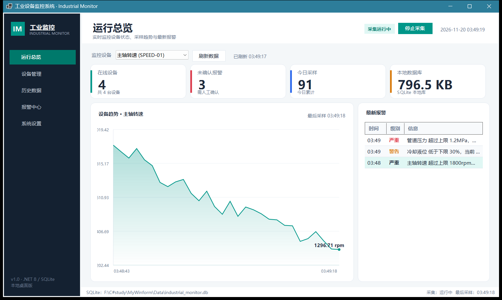
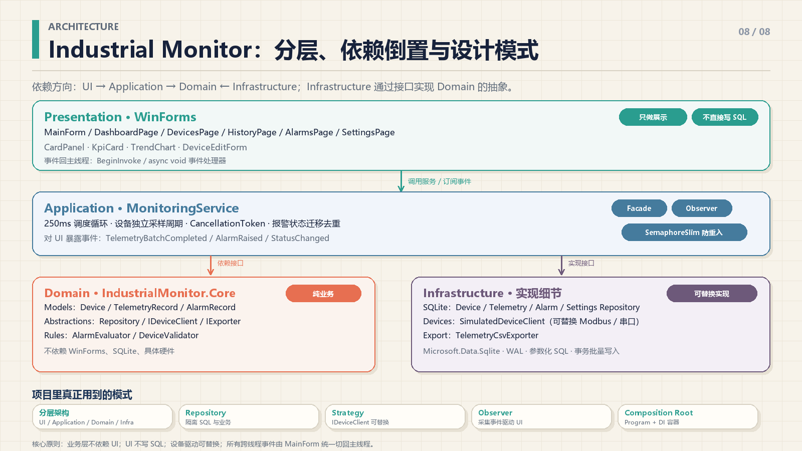

# Industrial Monitor

**工业设备监控与数据采集系统**  
一个面向“上位机开发”岗位的 .NET 8 + WinForms 实战项目：多设备异步采集、实时趋势、越限报警、历史查询、SQLite 持久化、CSV 导出。



## 功能

- 设备管理：新增、编辑、删除、启用/停用，设备独立采样周期
- 实时总览：在线设备、未确认报警、今日采样、数据库大小、趋势图、最新报警
- 后台采集：`MonitoringService` 250ms 调度循环，按设备周期读取 `IDeviceClient`
- 报警中心：警告/严重两级报警，报警确认人和确认时间留痕
- 历史数据：设备 + 时间范围 + 分页查询，CSV 导出
- 系统设置：操作员、数据保留天数、打开数据目录、清理过期采样
- 工程化：分层项目、Repository、依赖注入、设备策略、事件驱动、13 个单元测试

## 技术栈

| 层 | 技术 |
|---|---|
| UI | .NET 8 WinForms、TableLayoutPanel、DataGridView、GDI+ 自绘 |
| 应用层 | `MonitoringService`、`SemaphoreSlim`、`CancellationToken`、`Task.Delay` |
| 领域层 | 纯 C# 模型、校验规则、报警规则、Repository 接口 |
| 基础设施 | SQLite（`Microsoft.Data.Sqlite`）、WAL、参数化 SQL、事务批量写入 |
| 测试 | xUnit |

## 快速运行

### 前置条件

- Windows 10/11
- Visual Studio 2022（安装 **.NET 桌面开发** 工作负载）
- .NET 8 SDK（或更高版本 SDK，项目目标框架为 `net8.0-windows`）

### 启动

1. 打开 `IndustrialMonitor.sln`；
2. 等待 NuGet 还原（首次会下载 `Microsoft.Data.Sqlite` 和 DI 包）；
3. 右键 `IndustrialMonitor.WinForms` → **设为启动项目**；
4. `Ctrl + Shift + B` 生成解决方案；
5. `F5` 启动，等待约 5～10 秒，模拟设备会开始产生采样和报警。

默认数据库（自动创建，**不会写入 C 盘**）：

```text
F:\C#study\MyWinform\Data\industrial_monitor.db
```

主界面 → **系统设置** 可以直接打开数据目录。

> 本项目不再使用 `%LOCALAPPDATA%`：运行数据库、测试临时库和 NuGet 缓存都配置在 F 盘项目目录：
>
> - 数据：`F:\C#study\MyWinform\Data\`
> - NuGet 包：`F:\C#study\MyWinform\.nuget\packages\`
> - NuGet HTTP/临时/插件缓存：`F:\C#study\MyWinform\.nuget\http-cache\`、`.nuget\scratch\`、`.nuget\plugins-cache\`
> - 测试临时库：各测试项目 `bin\...\TestData\`
>
> `NuGet.Config` 已把 `globalPackagesFolder` 指向 F；NuGet HTTP 缓存/临时目录通过用户环境变量 `NUGET_HTTP_CACHE_PATH`、`NUGET_SCRATCH` 指向 F。换机器或移动项目时同步修改这些路径。

> 没有硬件也可以运行：`SimulatedDeviceClient` 用正弦波 + 噪声模拟温度、压力、转速、液位。  
> 要接真实设备，实现 `IDeviceClient` 并替换 DI 注册即可（Modbus TCP/RTU、串口、OPC UA 都适用）。

## 运行测试

```bash
dotnet test IndustrialMonitor.sln
```

当前测试覆盖：报警规则、设备校验、CSV 转义、SQLite 初始化/分页/报警确认。

## 项目结构

```text
IndustrialMonitor.sln
├── src/
│   ├── IndustrialMonitor.Core/            领域模型、接口、报警/采集服务
│   ├── IndustrialMonitor.Infrastructure/  SQLite 仓储、模拟设备、CSV 导出
│   └── IndustrialMonitor.WinForms/        WinForms UI、页面、自定义控件
├── tests/
│   └── IndustrialMonitor.Tests/           xUnit 测试
├── docs/
│   ├── 上位机项目开发文档.md
│   ├── 面试讲解与简历写法.md
│   └── screenshots/
└── _legacy/                               原始空项目（已归档，不参与构建）
```

## 架构



依赖方向：

```text
WinForms UI  →  Core（Models + Abstractions + Services）  ←  Infrastructure（SQLite / 模拟设备 / CSV）
```

UI 不直接写 SQL，Infrastructure 实现 Core 的接口；`Program.cs` 是唯一的组合根。

## 数据库说明

项目默认使用 **SQLite**，因为桌面/工控机部署通常要求：

- 零安装、单文件、易备份；
- 无数据库账号/端口配置；
- 本地历史数据量适中时足够。

本机检测到 MySQL80 服务正在运行，但没有可用的 root 凭据，因此项目没有把 MySQL 密码硬编码进源码。  
如果面试或生产环境要求 MySQL，可保持 `Core` 和 UI 不变，新增 `MySql*Repository` 并在 `Program.cs` 替换注册；详细迁移步骤见 [项目开发文档](docs/上位机项目开发文档.md)。

## 文档

- [上位机项目开发文档](docs/上位机项目开发文档.md)：完整功能、数据库、代码、控件、设计模式、调试与扩展
- [面试讲解与简历写法](docs/面试讲解与简历写法.md)：30 秒/2 分钟介绍、简历条目、常见追问

## 许可

仅用于学习、面试准备与个人作品展示。
