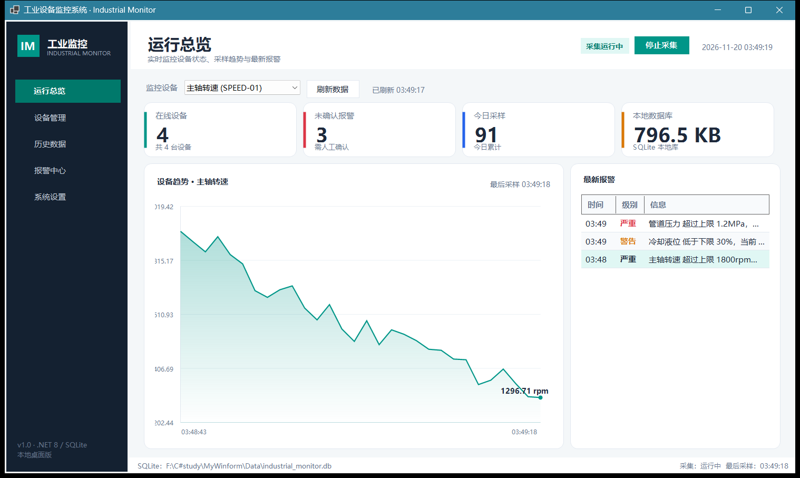
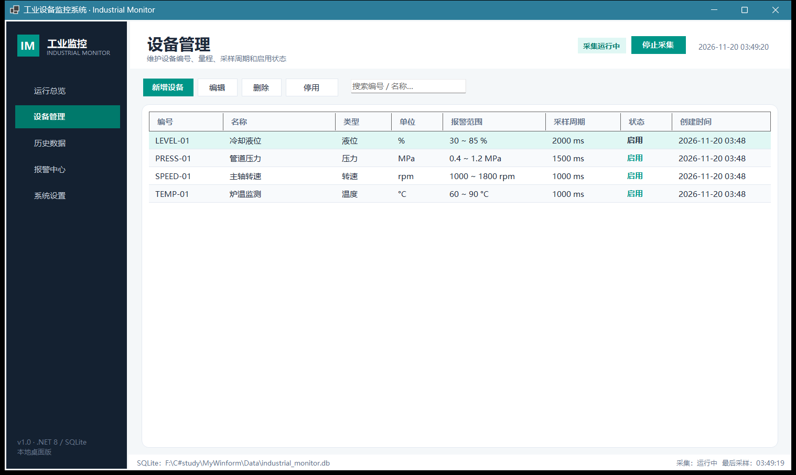
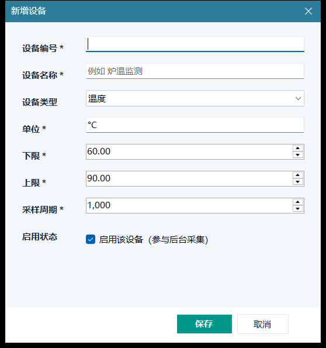
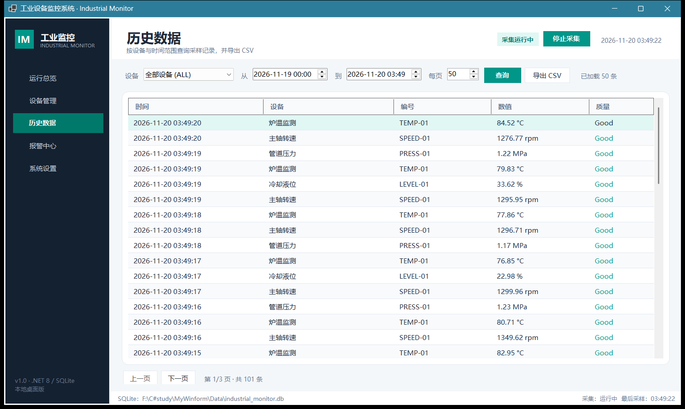
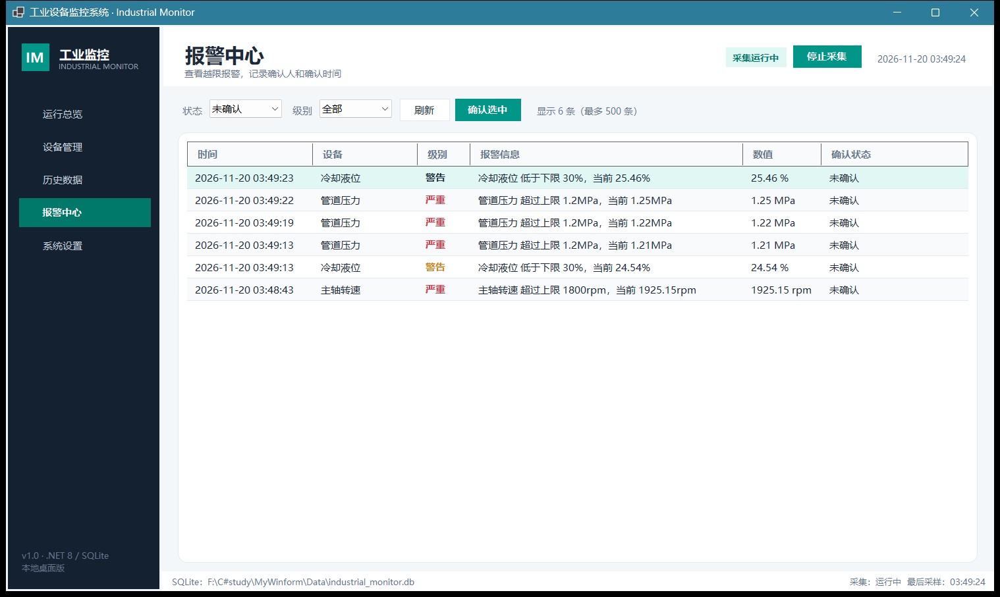
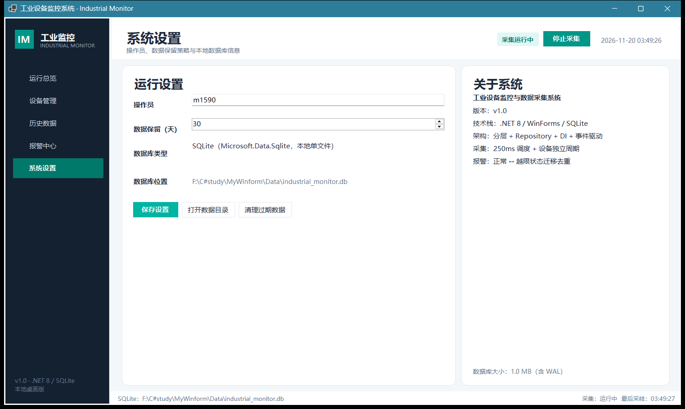
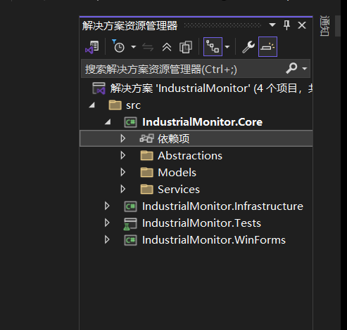
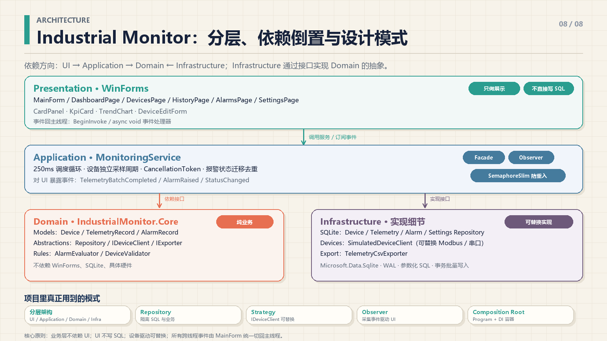

# 工业设备监控与数据采集系统 · 项目开发文档

> **项目代号**：Industrial Monitor  
> **项目类型**：WinForms 上位机 / 数据采集 / 实时监控 / 报警管理  
> **技术栈**：.NET 8、C# 12、WinForms、SQLite（Microsoft.Data.Sqlite）、xUnit、Visual Studio 2022  
> **文档版本**：v1.0 · 2026-11

---

## 0. 先看结论：这个项目能写进简历吗

可以，但它不是“增删改查 + 几个按钮”的练习，而是一个有**完整闭环**的上位机项目：

```text
设备配置 → 后台采集 → 实时曲线 → 阈值判断 → 报警落库 → 报警确认
        → 历史查询 → 分页 → CSV 导出 → 数据保留/清理
```

对应的简历描述可以写成：

> 基于 .NET 8 + WinForms 开发工业设备监控上位机，采用分层架构与 Repository/Strategy/Observer 模式；实现多设备异步采集、实时趋势、越级报警、历史分页查询与 CSV 导出；使用 SQLite WAL + 事务批量写入，支持 250ms 调度与设备独立采样周期；通过 DI 解耦 UI、业务与数据访问，并编写 xUnit 测试覆盖报警规则、校验与数据仓储。

项目里真正可以讲的点：

- **不是假异步**：采集循环使用 `Task.Delay` + `CancellationToken`，不阻塞 UI；
- **不是线程乱飞**：`SemaphoreSlim` 防止采集重入，数据库连接每次独立创建；
- **报警不是每帧刷屏**：只在“正常 ↔ 越限”或等级变化时生成报警；
- **UI 不写 SQL**：仓储接口在 Core，SQLite 实现在 Infrastructure；
- **设备可替换**：`IDeviceClient` 是策略接口，模拟器只是其中一种实现；
- **可测试**：报警规则、设备校验、CSV、SQLite 查询都有 xUnit 测试。

---

## 1. 功能与截图

### 1.1 功能清单

| 模块 | 功能 | 实现情况 |
|---|---|---|
| 运行总览 | 在线设备数、未确认报警、今日采样、数据库大小 | ✅ |
| 运行总览 | 实时趋势图（最多 60 点）、最新报警列表 | ✅ |
| 设备管理 | 新增、编辑、删除、启用/停用、搜索 | ✅ |
| 设备管理 | 独立采样周期、上下限、单位、类型 | ✅ |
| 后台采集 | 250ms 调度循环，按设备周期读取 | ✅ |
| 报警中心 | 警告/严重两级、确认人/确认时间、筛选 | ✅ |
| 历史数据 | 设备 + 时间范围 + 分页查询 | ✅ |
| 历史数据 | CSV 导出（UTF-8 BOM，Excel 友好） | ✅ |
| 系统设置 | 操作员、数据保留天数、打开数据目录、清理 | ✅ |
| 设备接入 | 模拟设备（温度/压力/转速/液位） | ✅ |
| 设备接入 | Modbus TCP/RTU、串口、OPC UA | 🔌 预留 `IDeviceClient`，未接硬件 |
| 账户体系 | 登录、角色、权限 | ⏳ 未实现（可扩展） |
| 数据库 | SQLite 本地库 | ✅ |
| 数据库 | MySQL 切换 | 🔌 已写迁移步骤，未启用 |

### 1.2 运行总览



### 1.3 设备管理



### 1.4 新增设备



### 1.5 历史数据



### 1.6 报警中心



### 1.7 系统设置



---

## 2. 傻瓜式复现教程

### 2.1 环境检查

| 项 | 要求 | 本机检测 |
|---|---|---|
| Windows | 10/11 | Windows 10.0.26200 |
| Visual Studio | 2022，安装“.NET 桌面开发” | VS Community 2022 17.14 |
| .NET SDK | 8.0 或更高（项目目标 `net8.0-windows`） | 9.0.321，可编译 net8.0 |
| 数据库 | SQLite 随 NuGet 包自动携带 | 可用 |
| MySQL | 可选 | MySQL80 服务运行，但 root 无可用凭据 |

> 为什么默认用 SQLite：这是桌面上位机最常见的“零配置”存储方案。MySQL80 虽然在本机运行，但没有提供密码，把密码硬编码到项目里既不安全也不利于复现。迁移 MySQL 的步骤见第 10 章。

### 2.2 在 Visual Studio 中打开



1. 双击项目根目录的 `IndustrialMonitor.sln`；
2. 首次打开等待右下角 **“正在还原 NuGet 程序包”** 完成；
3. 在右侧“解决方案资源管理器”中确认有 4 个项目：
   - `IndustrialMonitor.Core`
   - `IndustrialMonitor.Infrastructure`
   - `IndustrialMonitor.WinForms`
   - `IndustrialMonitor.Tests`
4. 右键 `IndustrialMonitor.WinForms` → **设为启动项目**；
5. 顶部工具栏确认 `Debug` + `Any CPU`；
6. 按 `Ctrl + Shift + B` 生成解决方案；
7. 按 `F5` 启动。

如果 NuGet 没有自动还原：

```text
右键解决方案 → 还原 NuGet 程序包
```

如果提示 `net8.0-windows` 找不到：

```text
安装 .NET 8 SDK / .NET 8 Desktop Runtime
或在项目文件中把 TargetFramework 改成你机器已安装的版本
```

### 2.3 第一次启动看到什么

启动后会：

1. 在项目根目录的 `Data\` 创建 `industrial_monitor.db`（默认 `F:\C#study\MyWinform\Data\`）；
2. 自动建表；
3. 插入 4 台模拟设备：
   - `TEMP-01` 炉温监测（60～90 °C）
   - `PRESS-01` 管道压力（0.4～1.2 MPa）
   - `SPEED-01` 主轴转速（1000～1800 rpm）
   - `LEVEL-01` 冷却液位（30～85 %）
4. 启动后台采集，约 5～10 秒后可以看到曲线和报警。

### 2.4 新增一台设备（练手流程）

1. 左侧点击 **设备管理**；
2. 点击 **新增设备**；
3. 填写：
   - 编号：`TEMP-02`
   - 名称：`炉温监测 2`
   - 类型：`温度`
   - 单位：`°C`
   - 下限：`50`
   - 上限：`80`
   - 采样周期：`1000`
   - 启用：勾选；
4. 点击 **保存**；
5. 新设备会出现在列表里，下一轮采集调度会自动读取它，无需重启。

> 如果要新增“振动”设备类型，需要同时扩展 `DeviceType` 枚举、模拟器分支和 UI 显示；面试时可以把它作为“新增设备类型”的扩展题。

### 2.5 看历史、导出

1. 左侧点击 **历史数据**；
2. 设备选“全部设备”，时间范围默认最近一天；
3. 点击 **查询**；
4. 点击 **导出 CSV**，选择保存位置；
5. CSV 用 Excel 打开时中文不会乱码（UTF-8 BOM + 引号转义）。

### 2.6 处理报警

1. 左侧点击 **报警中心**；
2. 状态筛选选择 **未确认**；
3. 选中一行或多行（`MultiSelect=true`）；
4. 点击 **确认选中**；
5. 状态变为“已确认”，并记录操作员和确认时间。

### 2.7 停止与重置

- 右上角 **停止采集** 可暂停后台循环；
- 关闭窗口时程序会先停止采集再退出；
- 重置演示数据：

```powershell
# 先关闭程序
Get-Process IndustrialMonitor.WinForms -ErrorAction SilentlyContinue | Stop-Process
Remove-Item "F:\C#study\MyWinform\Data\industrial_monitor.db*" -Force
```

重新启动即可重新建库和插入 4 台演示设备。

### 2.8 命令行运行与测试

```powershell
cd F:\C#study\MyWinform
dotnet build IndustrialMonitor.sln
dotnet run --project src\IndustrialMonitor.WinForms\IndustrialMonitor.WinForms.csproj
dotnet test IndustrialMonitor.sln
```

---

## 3. 总体架构



### 3.1 四个项目

| 项目 | 职责 | 不应该做什么 |
|---|---|---|
| `IndustrialMonitor.Core` | 领域模型、接口、报警规则、采集编排 | 不引用 WinForms、SQLite |
| `IndustrialMonitor.Infrastructure` | SQLite 仓储、模拟设备、CSV 导出 | 不包含 UI 逻辑 |
| `IndustrialMonitor.WinForms` | 窗体、页面、自定义控件、DI 组合根 | 不直接拼 SQL |
| `IndustrialMonitor.Tests` | 规则/仓储/导出测试 | 不依赖 UI |

依赖关系：

```text
WinForms ──→ Core ←── Infrastructure
   │            │
   └────────────┘（通过接口 + DI 注入）
```

`Core` 定义 `IDeviceRepository`、`ITelemetryRepository`、`IAlarmRepository`、`IDeviceClient` 等抽象；`Infrastructure` 实现它们。UI 只依赖抽象。

### 3.2 数据流

```text
① UI 启动
   MainForm.Shown → MonitoringService.StartAsync()

② 后台循环
   while (!canceled)
     → 每 250ms 检查一次
     → 读取启用设备
     → 按每台设备的 SamplingIntervalMs 判断是否到期
     → IDeviceClient.ReadAsync(device)
     → 批量写 Telemetry
     → AlarmEvaluator 判断越限
     → 状态迁移时写 Alarms

③ 通知 UI
   TelemetryBatchCompleted / AlarmRaised / StatusChanged
     → MainForm.RunOnUi(BeginInvoke)
     → Dashboard/History/Alarms 页面刷新

④ 用户操作
   新增/编辑设备 → Repository → SQLite
   查询历史 → Repository 分页 → DataGridView
   确认报警 → Repository 更新 → 刷新
```

### 3.3 组合根

`Program.cs` 是唯一组装对象图的地方，使用 `Microsoft.Extensions.DependencyInjection`：

```csharp
services.AddSingleton(paths);
services.AddSingleton(new AppOptions());
services.AddSingleton<ISqliteConnectionFactory>(
    _ => new SqliteConnectionFactory(paths.DatabasePath));
services.AddSingleton<IDatabaseInitializer, DatabaseInitializer>();
services.AddSingleton<IDeviceRepository, SqliteDeviceRepository>();
services.AddSingleton<ITelemetryRepository, SqliteTelemetryRepository>();
services.AddSingleton<IAlarmRepository, SqliteAlarmRepository>();
services.AddSingleton<ISettingsRepository, SqliteSettingsRepository>();
services.AddSingleton<IDeviceClient, SimulatedDeviceClient>();
services.AddSingleton<ITelemetryCsvExporter, TelemetryCsvExporter>();
services.AddSingleton<MonitoringService>();

services.AddSingleton<DashboardPage>();
services.AddSingleton<DevicesPage>();
services.AddSingleton<HistoryPage>();
services.AddSingleton<AlarmsPage>();
services.AddSingleton<SettingsPage>();
services.AddSingleton<MainForm>();
```

生命周期：

| 对象 | 生命周期 | 原因 |
|---|---|---|
| `AppPaths` / `AppOptions` | Singleton | 全局共享 |
| Repository | Singleton | 无状态，只持有连接工厂 |
| `MonitoringService` | Singleton | 整个应用只有一个采集循环 |
| 页面 | Singleton | 保留筛选状态/控件实例 |
| `MainForm` | Singleton | 应用主窗口 |

### 3.4 目录结构

```text
src/
├── IndustrialMonitor.Core/
│   ├── Models/
│   │   ├── Device.cs
│   │   ├── DeviceType.cs
│   │   ├── TelemetryRecord.cs
│   │   ├── AlarmRecord.cs
│   │   ├── AlarmQuery.cs
│   │   ├── PagedResult.cs
│   │   └── AppOptions.cs
│   ├── Abstractions/
│   │   ├── IDeviceRepository.cs
│   │   ├── ITelemetryRepository.cs
│   │   ├── IAlarmRepository.cs
│   │   ├── ISettingsRepository.cs
│   │   ├── IDeviceClient.cs
│   │   └── ITelemetryCsvExporter.cs
│   └── Services/
│       ├── AlarmEvaluator.cs
│       ├── DeviceValidator.cs
│       └── MonitoringService.cs
│
├── IndustrialMonitor.Infrastructure/
│   ├── Data/
│   │   ├── SqliteConnectionFactory.cs
│   │   ├── DatabaseInitializer.cs
│   │   ├── SqliteDeviceRepository.cs
│   │   ├── SqliteTelemetryRepository.cs
│   │   ├── SqliteAlarmRepository.cs
│   │   └── SqliteSettingsRepository.cs
│   ├── Devices/SimulatedDeviceClient.cs
│   └── Export/TelemetryCsvExporter.cs
│
└── IndustrialMonitor.WinForms/
    ├── Program.cs
    ├── Infrastructure/AppPaths.cs
    └── UI/
        ├── UiTheme.cs
        ├── IPage.cs
        ├── Controls/
        │   ├── CardPanel.cs
        │   ├── KpiCard.cs
        │   └── TrendChart.cs
        ├── Forms/
        │   ├── MainForm.cs
        │   └── DeviceEditForm.cs
        └── Pages/
            ├── DashboardPage.cs
            ├── DevicesPage.cs
            ├── HistoryPage.cs
            ├── AlarmsPage.cs
            └── SettingsPage.cs
```

---

## 4. 数据库设计（SQLite）

### 4.1 为什么是 SQLite

本项目是**单机桌面上位机**，SQLite 的优势非常直接：

- 零安装，随程序运行；
- 单文件，备份/拷贝简单；
- 无需账号、端口、服务；
- 支持事务、索引、WAL，足够支撑中小规模历史数据；
- 对工控机/现场电脑更友好。

MySQL 更适合多客户端共享、集中部署、大数据量/报表场景；如果项目要部署成“多台上位机 + 中央数据库”，再切 MySQL。

本机 MySQL80 正在运行，但没有可用的 root 凭据，因此没有把密码写进代码。项目默认 SQLite，切换 MySQL 的步骤见第 10 章。

### 4.2 数据库位置

```text
F:\C#study\MyWinform\Data\industrial_monitor.db
```

对应代码：[AppPaths.cs](../src/IndustrialMonitor.WinForms/Infrastructure/AppPaths.cs)

`AppPaths` 在启动时创建目录；`DatabaseInitializer` 负责建表和种子数据。

本项目所有持久化与测试临时数据都落在 F 盘项目目录：

```text
F:\C#study\MyWinform\Data\                      运行数据库
F:\C#study\MyWinform\.nuget\packages\           NuGet 包缓存
F:\C#study\MyWinform\tests\...\bin\...\TestData\ 测试临时库
```

`AppPaths` 不再引用 `Environment.SpecialFolder.LocalApplicationData`。开发/调试时向上查找 `IndustrialMonitor.sln`，使用解决方案根目录下的 `Data`；发布后使用程序所在目录下的 `Data`。也可以用环境变量 `INDUSTRIAL_MONITOR_HOME` 指定其他非 C 盘目录。

NuGet 也不写 C 盘：

- `NuGet.Config` 的 `globalPackagesFolder` 指向 `.nuget\packages`；
- 用户环境变量 `NUGET_HTTP_CACHE_PATH` 指向 `.nuget\http-cache`；
- 用户环境变量 `NUGET_SCRATCH` 指向 `.nuget\scratch`；
- 用户环境变量 `NUGET_PLUGINS_CACHE_PATH` 指向 `.nuget\plugins-cache`。

换机器/移动项目后执行：

```powershell
[Environment]::SetEnvironmentVariable(
  'NUGET_HTTP_CACHE_PATH', 'F:\C#study\MyWinform\.nuget\http-cache', 'User')
[Environment]::SetEnvironmentVariable(
  'NUGET_SCRATCH', 'F:\C#study\MyWinform\.nuget\scratch', 'User')
[Environment]::SetEnvironmentVariable(
  'NUGET_PLUGINS_CACHE_PATH', 'F:\C#study\MyWinform\.nuget\plugins-cache', 'User')
```

### 4.3 表结构

```sql
CREATE TABLE Devices (
    Id INTEGER PRIMARY KEY AUTOINCREMENT,
    Code TEXT NOT NULL UNIQUE,
    Name TEXT NOT NULL,
    Type INTEGER NOT NULL,
    Unit TEXT NOT NULL,
    LowLimit REAL NOT NULL,
    HighLimit REAL NOT NULL,
    SamplingIntervalMs INTEGER NOT NULL,
    IsEnabled INTEGER NOT NULL DEFAULT 1,
    CreatedAtUtc TEXT NOT NULL
);

CREATE TABLE Telemetry (
    Id INTEGER PRIMARY KEY AUTOINCREMENT,
    DeviceId INTEGER NOT NULL,
    Value REAL NOT NULL,
    Quality TEXT NOT NULL,
    CollectedAtUtc TEXT NOT NULL,
    FOREIGN KEY (DeviceId) REFERENCES Devices(Id) ON DELETE CASCADE
);

CREATE TABLE Alarms (
    Id INTEGER PRIMARY KEY AUTOINCREMENT,
    DeviceId INTEGER NOT NULL,
    Level INTEGER NOT NULL,
    Message TEXT NOT NULL,
    Value REAL NOT NULL,
    Unit TEXT NOT NULL,
    OccurredAtUtc TEXT NOT NULL,
    IsAcknowledged INTEGER NOT NULL DEFAULT 0,
    AcknowledgedAtUtc TEXT NULL,
    AcknowledgedBy TEXT NULL,
    FOREIGN KEY (DeviceId) REFERENCES Devices(Id) ON DELETE CASCADE
);

CREATE TABLE Settings (
    Key TEXT PRIMARY KEY,
    Value TEXT NOT NULL
);
```

索引：

```sql
CREATE INDEX IX_Telemetry_Device_Time
    ON Telemetry(DeviceId, CollectedAtUtc DESC);

CREATE INDEX IX_Telemetry_Time
    ON Telemetry(CollectedAtUtc DESC);

CREATE INDEX IX_Alarms_Time
    ON Alarms(OccurredAtUtc DESC);

CREATE INDEX IX_Alarms_Ack
    ON Alarms(IsAcknowledged, OccurredAtUtc DESC);
```

### 4.4 设计说明

**为什么时间存 TEXT 而不是 DATETIME？**

SQLite 没有真正的 `DATETIME` 类型，常用 ISO 8601 字符串。项目用：

```csharp
value.ToUniversalTime().ToString("O", CultureInfo.InvariantCulture)
```

保存为 `2026-11-20T18:42:15.6480429Z` 形式。优点：

- 可读；
- 字典序即时间序；
- 跨时区统一；
- 反序列化稳定。

展示时统一转本地时间：

```csharp
DateTime.Parse(...).ToUniversalTime().ToLocalTime()
```

**为什么 Telemetry 不存设备名？**

设备名通过 `JOIN Devices` 获取，避免设备改名后历史记录出现两套名称。代价是查询多一个 JOIN，但设备表很小。

**为什么 Settings 用 Key-Value？**

设置项少、变化频繁，用 KV 表比加一张宽表更灵活；后续加配置项不需要改表结构。

### 4.5 批量写入与 WAL

`SqliteTelemetryRepository.InsertBatchAsync`：

1. 一次连接；
2. 一个事务；
3. 复用 `SqliteCommand` 与参数；
4. 循环执行；
5. `Commit`。

```csharp
using var transaction = connection.BeginTransaction();
await using var command = connection.CreateCommand();
command.Transaction = transaction;
// 复用参数，逐条写入
transaction.Commit();
```

连接串开启：

- `Cache=Shared`；
- `ForeignKeys=true`；
- `busy_timeout=5000`；
- `journal_mode=WAL`。

WAL 允许读写并发更顺畅，减少 UI 查询与后台写入互相阻塞。

### 4.6 分页查询

历史页调用：

```csharp
var page = await _telemetry.QueryAsync(
    deviceId,
    fromUtc,
    toUtc,
    page: 1,
    pageSize: 50);
```

仓储先生成 `WHERE` 条件，再：

```sql
SELECT ...
FROM Telemetry t
INNER JOIN Devices d ON d.Id = t.DeviceId
WHERE ...
ORDER BY t.CollectedAtUtc DESC
LIMIT $take OFFSET $skip;
```

同时单独执行 `COUNT(*)` 得到总条数。页面 size 限制在 10～500，避免一次拉爆内存。

---

## 5. 采集与报警核心

### 5.1 调度循环

文件：[MonitoringService.cs](../src/IndustrialMonitor.Core/Services/MonitoringService.cs)

核心参数：

```csharp
private const int SchedulerTickMs = 250;
private const int MinSamplingMs = 200;
private const int MaxSamplingMs = 60_000;
```

含义：

- 调度器每 250ms 醒来一次；
- 每台设备有自己的 `SamplingIntervalMs`；
- 只有到达设备周期的设备才会被读取；
- 不是“所有设备每 250ms 读一次”。

简化逻辑：

```text
while (!cancelled):
    foreach device in enabledDevices:
        if now - lastSample[device] < device.Interval:
            continue

        reading = await deviceClient.ReadAsync(device)
        telemetry.Add(reading)
        alarm = AlarmEvaluator.Evaluate(device, reading)
        if alarm level changed:
            alarms.Add(alarm)

    if telemetry.Any(): await telemetryRepo.InsertBatchAsync(telemetry)
    foreach alarm: await alarmRepo.InsertAsync(alarm)
    raise TelemetryBatchCompleted / AlarmRaised
    await Task.Delay(250, token)
```

### 5.2 为什么用 `Task.Delay` 而不是 `Thread.Sleep`

```csharp
await Task.Delay(SchedulerTickMs, cancellationToken);
```

- 不阻塞线程池线程；
- 可被 `CancellationToken` 打断；
- UI 停止采集时能快速退出；
- 不会出现“点停止后还要等 1 秒”的体验。

### 5.3 防重入

```csharp
await _collectGate.WaitAsync(cancellationToken);
try { ... }
finally { _collectGate.Release(); }
```

`SemaphoreSlim(1,1)` 保证：

- 后台循环不会同时进入两次采集；
- 如果未来增加“立即采集”按钮，也不会和后台循环打架；
- 字典 `_lastSampleAt`/`_lastAlarmLevel` 只在持锁期间访问，避免竞态。

### 5.4 启停生命周期

```csharp
await _monitor.StartAsync();  // 创建 CTS + Task.Run
await _monitor.StopAsync();   // Cancel + await + Dispose
```

- `_lifecycleGate` 保证 Start/Stop 不并发；
- `StopAsync` 取消后等待循环结束，避免后台任务在窗口销毁后还访问 UI；
- `FormClosing` 中异步等待停止，完成后再真正关闭窗口。

### 5.5 报警规则

文件：[AlarmEvaluator.cs](../src/IndustrialMonitor.Core/Services/AlarmEvaluator.cs)

规则：

```text
value >= HighLimit → Critical
value <= LowLimit  → Warning
否则               → Normal
```

报警去重：

```csharp
_lastAlarmLevel.TryGetValue(device.Id, out var previousLevel);
if (evaluation.Level is { } level)
{
    if (previousLevel != level)
    {
        // 只有等级变化才插入新报警
        _lastAlarmLevel[device.Id] = level;
    }
}
else
{
    _lastAlarmLevel[device.Id] = null;
}
```

因此：

- 持续越限不会每个 250ms 插入一条；
- 从正常进入越限会插入；
- 从警告升级为严重会插入；
- 回到正常后再次越限会插入新报警。

> 可扩展：加入死区/迟滞（hysteresis）和报警冷却时间，避免值在阈值附近抖动时频繁切换。当前版本故意保持规则简单，便于测试和面试讲解。

### 5.6 UI 线程切换

采集事件在后台线程触发：

```csharp
TelemetryBatchCompleted?.Invoke(this, new TelemetryBatchEventArgs(readings));
```

WinForms 控件只能在 UI 线程更新，所以 `MainForm` 统一转回主线程：

```csharp
private void RunOnUi(Action action)
{
    if (IsDisposed || Disposing) return;

    if (InvokeRequired)
    {
        if (!IsHandleCreated) return;
        BeginInvoke(action);
        return;
    }

    action();
}
```

为什么用 `BeginInvoke` 而不是 `Invoke`：

- `BeginInvoke` 投递消息后立即返回，不会让后台采集线程等 UI；
- 避免 UI 忙时把采集循环拖慢。

### 5.7 异常处理

- 后台循环整体 `try/catch`，异常写入 `LastError`，通过 `StatusChanged` 通知 UI；
- 设备读取/数据库异常不会让整个应用崩溃，下一轮会重试；
- UI 操作（新增设备、确认报警）各自 `try/catch`，用 `MessageBox` 提示；
- `Program.cs` 捕获启动失败和未处理异常。

> 生产项目建议加文件日志（NLog/Serilog），当前项目为减少依赖，只做了 UI 状态提示。

---

## 6. WinForms 控件与字段属性

> 本项目界面主要用代码构建，而不是依赖 `.Designer.cs` 拖拽。原因是仪表盘、卡片、图表都是动态布局，代码更容易审查和复现。  
> Visual Studio 仍然可以打开、调试、查看控件；下面的控件表可以让你在设计器里复刻同样的界面。

### 6.1 主窗体：`MainForm`

文件：[MainForm.cs](../src/IndustrialMonitor.WinForms/UI/Forms/MainForm.cs)

关键字段：

| 字段 | 类型 | 作用 |
|---|---|---|
| `_monitor` | `MonitoringService` | 启动/停止采集、订阅事件 |
| `_pages` | `Dictionary<string,(Button,IPage)>` | 页面与导航按钮映射 |
| `_navButtons` | `Dictionary<string,Button>` | 左侧导航按钮 |
| `_content` | `Panel` | 页面容器 |
| `_pageTitle` / `_pageSubtitle` | `Label` | 顶部标题 |
| `_monitorPill` | `Label` | 采集状态徽章 |
| `_toggleMonitor` | `Button` | 启动/停止采集 |
| `_clock` | `Label` | 当前时间 |
| `_statusDb` | `ToolStripStatusLabel` | 数据库路径 |
| `_statusMonitor` | `ToolStripStatusLabel` | 采集状态 |
| `_statusLast` | `ToolStripStatusLabel` | 最后采样时间 |
| `_clockTimer` | `System.Windows.Forms.Timer` | 秒级时钟 |
| `_allowClose` | `bool` | 防止关闭流程重入 |

窗体属性：

| 属性 | 本项目值 | 说明 |
|---|---|---|
| `Text` | `工业设备监控系统 · Industrial Monitor` | 标题栏 |
| `StartPosition` | `CenterScreen` | 居中 |
| `ClientSize` | `1500 × 860` | 适合 1920×1080 |
| `MinimumSize` | `1180 × 760` | 防止布局挤坏 |
| `BackColor` | `#F4F7F9` | 页面底色 |
| `Font` | 微软雅黑 9pt | 中文显示 |
| `AutoScaleMode` | `Dpi` | 高 DPI |
| `WindowState` | `Normal` | 可手动最大化 |
| `Shown` | 启动首页 + 采集 | 事件 |
| `FormClosing` | 先停止采集 | 事件 |

### 6.2 布局：`TableLayoutPanel`

主窗体用 2 列 × 3 行：

```text
┌──────────┬─────────────────────────────┐
│          │ Header（标题/状态/操作）      │
│ Sidebar  ├─────────────────────────────┤
│          │ Content（页面容器）          │
│          ├─────────────────────────────┤
│          │ StatusStrip                 │
└──────────┴─────────────────────────────┘
```

关键属性：

| 属性 | 作用 |
|---|---|
| `Dock = Fill` | 填满父容器 |
| `ColumnCount` / `RowCount` | 行列数 |
| `ColumnStyles` / `RowStyles` | 绝对/百分比尺寸 |
| `Controls.Add(control, col, row)` | 指定单元格 |
| `SetRowSpan` / `SetColumnSpan` | 跨行/跨列 |
| `Padding` | 内边距 |

代码：

```csharp
var root = new TableLayoutPanel
{
    Dock = DockStyle.Fill,
    ColumnCount = 2,
    RowCount = 3
};
root.ColumnStyles.Add(new ColumnStyle(SizeType.Absolute, 236));
root.ColumnStyles.Add(new ColumnStyle(SizeType.Percent, 100));
root.RowStyles.Add(new RowStyle(SizeType.Absolute, 96));
root.RowStyles.Add(new RowStyle(SizeType.Percent, 100));
root.RowStyles.Add(new RowStyle(SizeType.Absolute, 30));
```

### 6.3 导航按钮：`Button`

| 属性 | 值/说明 |
|---|---|
| `Text` | 导航文字 |
| `Tag` | 早期版本用于标识；现在由 `_navButtons` 字典管理 |
| `Width/Height` | `208 × 44` |
| `Dock` | 放在 `FlowLayoutPanel` 中，不设置 |
| `FlatStyle` | `Flat` |
| `FlatAppearance.BorderSize` | `0` |
| `BackColor` / `ForeColor` | 深色侧栏 / 浅灰文字 |
| `TextAlign` | `MiddleLeft` |
| `Padding` | `12,0,0,0` |
| `Cursor` | `Hand` |
| `Click` | 切换页面 |
| `Font` | 选中时加粗 |

### 6.4 顶部状态：`Label` + `FlowLayoutPanel`

`Label` 关键属性：

| 属性 | 说明 |
|---|---|
| `Text` | 显示文本 |
| `AutoSize` | 标题/说明为 true；状态徽章为 false |
| `Font` | 字号/粗细 |
| `ForeColor` / `BackColor` | 文字/底色 |
| `TextAlign` | 徽章居中 |
| `Dock` / `Anchor` | 布局 |
| `Padding` | 徽章留白 |

`FlowLayoutPanel`：

| 属性 | 说明 |
|---|---|
| `Dock = Right` | 顶部右侧操作区 |
| `FlowDirection = LeftToRight` | 横向排列 |
| `WrapContents = false` | 不换行 |
| `Width` | 固定 380，避免挤压标题 |

### 6.5 卡片容器：`CardPanel`（自定义）

文件：[CardPanel.cs](../src/IndustrialMonitor.WinForms/UI/Controls/CardPanel.cs)

继承 `Panel`，重写：

```csharp
protected override void OnPaintBackground(PaintEventArgs e)
protected override void OnPaint(PaintEventArgs e)
```

字段/属性：

| 成员 | 类型 | 作用 |
|---|---|---|
| `CornerRadius` | `int` | 圆角半径 |
| `BorderColor` | `Color` | 边框色 |
| `FillColor` | `Color` | 填充色 |
| `DoubleBuffered` | `bool` | 减少闪烁 |
| `Padding` | `Padding` | 内边距 |
| `OnPaint` | 方法 | 用 `GraphicsPath` + `Pen` + `SolidBrush` 画圆角 |

知识点：

- `Graphics.SmoothingMode = AntiAlias`；
- `GraphicsPath.AddArc` 画四角；
- `Pen`/`Brush` 用 `using` 释放；
- `OnPaintBackground` 先清父容器背景，避免圆角外出现白块。

### 6.6 指标卡：`KpiCard`（自定义）

文件：[KpiCard.cs](../src/IndustrialMonitor.WinForms/UI/Controls/KpiCard.cs)

字段/属性：

| 成员 | 类型 | 作用 |
|---|---|---|
| `Caption` | `string` | 指标名 |
| `AccentColor` | `Color` | 左侧色条 |
| `SetValue(string,string?)` | 方法 | 更新主数值/说明 |
| `OnPaint` | 方法 | 自绘卡片 |
| `DoubleBuffered` | `bool` | 双缓冲 |

绘制内容：

- 圆角白底 + 细边框；
- 左侧 5px 色条；
- 标题 9pt；
- 主数值 22pt 加粗；
- 底部说明 8pt。

为什么不用 4 个 Panel + 6 个 Label：自绘减少控件数量，布局更稳定，也便于统一视觉。

### 6.7 趋势图：`TrendChart`（自定义 GDI+ 图表）

文件：[TrendChart.cs](../src/IndustrialMonitor.WinForms/UI/Controls/TrendChart.cs)

关键属性：

| 属性 | 说明 |
|---|---|
| `MaxPoints` | 最多保留点数，默认 60 |
| `SeriesColor` | 折线/面积颜色 |
| `Unit` | 单位，用于最后一点标注 |
| `SetSeries(...)` | 设置整段数据 |
| `Append(...)` | 追加一个点并裁剪 |
| `Clear()` | 清空 |
| `EmptyText` | 空状态提示 |

绘制流程：

1. `OnPaint` 里 `SmoothingMode = AntiAlias`；
2. 计算绘图区 `plot`（留出左边距/底部时间轴）；
3. 计算 min/max，留 15% padding；
4. 画 4 条水平网格线 + Y 轴刻度；
5. 将每个点映射为 `PointF`；
6. 用 `GraphicsPath` 构造面积路径；
7. `LinearGradientBrush` 从颜色到透明填充；
8. `DrawLines` 画折线；
9. 最后一点画圆点 + 数值标签。

关键代码：

```csharp
var y = plot.Bottom
      - (float)((value - min) / (max - min)) * plot.Height;
```

`DoubleBuffered` + `ResizeRedraw` + `UserPaint` 由构造函数设置，避免闪烁。

### 6.8 数据表格：`DataGridView`

用于设备列表、历史数据、报警列表、最新报警。

关键属性：

| 属性 | 本项目值 | 说明 |
|---|---|---|
| `Dock` | `Fill` | 填满卡片 |
| `ReadOnly` | `true` | 只读展示 |
| `AllowUserToAddRows` | `false` | 不显示空白行 |
| `AllowUserToDeleteRows` | `false` | 禁止直接删 |
| `RowHeadersVisible` | `false` | 隐藏行头 |
| `SelectionMode` | `FullRowSelect` | 整行选中 |
| `MultiSelect` | 报警页 `true` | 多选确认 |
| `AutoGenerateColumns` | `false` | 手动定义列 |
| `AutoSizeColumnsMode` | `Fill` | 自动填满 |
| `EnableHeadersVisualStyles` | `false` | 自定义表头样式 |
| `ColumnHeadersHeight` | 38 | 表头高度 |
| `RowTemplate.Height` | 34 | 行高 |
| `DataSource` | `List<T>` / `BindingList<T>` | 数据绑定 |

常用事件：

| 事件 | 用途 |
|---|---|
| `CellFormatting` | 报警级别/状态上色 |
| `CellDoubleClick` | 双击设备进入编辑 |
| `SelectionChanged` | 更新“启用/停用”按钮文字 |

常用成员：

| 成员 | 用途 |
|---|---|
| `CurrentRow.DataBoundItem` | 取选中对象 |
| `SelectedRows` | 多选报警 |
| `Columns.Add(...)` | 手动列 |
| `DataPropertyName` | 绑定模型属性 |
| `FillWeight` | 列宽比例 |
| `DefaultCellStyle` | 单元格样式 |

列定义示例：

```csharp
UiTheme.AddTextColumn(_grid, "编号", nameof(Device.Code), 80);
UiTheme.AddTextColumn(_grid, "名称", nameof(Device.Name), 120);
UiTheme.AddTextColumn(_grid, "状态", nameof(Device.EnabledText), 55);
```

### 6.9 输入控件

#### `TextBox`

| 属性 | 说明 |
|---|---|
| `Text` | 输入值 |
| `PlaceholderText` | 占位提示（.NET 6+） |
| `MaxLength` | 最大长度 |
| `Dock` | 填满表格单元格 |
| `TextChanged` | 设备搜索实时过滤 |

#### `ComboBox`

| 属性/事件 | 说明 |
|---|---|
| `DataSource` | 设备列表 / 枚举 |
| `DisplayMember` | 显示属性，如 `DisplayName` |
| `ValueMember` | 值属性，如 `Id` |
| `DropDownStyle = DropDownList` | 禁止手输 |
| `SelectedItem` | 当前对象 |
| `SelectedIndexChanged` | 切换设备刷新曲线 |
| `FormattingEnabled` + `Format` | 把 `DeviceType` 显示成中文 |
| `Items.AddRange` | 状态下拉项 |

#### `NumericUpDown`

| 属性 | 说明 |
|---|---|
| `Minimum` / `Maximum` | 范围 |
| `Value` | 当前值 |
| `DecimalPlaces` | 小数位 |
| `Increment` | 步长 |
| `ThousandsSeparator` | 千分位 |

#### `CheckBox`

| 属性 | 说明 |
|---|---|
| `Text` | 说明文字 |
| `Checked` | 是否启用设备 |
| `AutoSize` | 自适应 |

#### `DateTimePicker`

| 属性 | 说明 |
|---|---|
| `Format = Custom` | 自定义格式 |
| `CustomFormat = "yyyy-MM-dd HH:mm"` | 时间显示 |
| `ShowUpDown = true` | 用上下箭头调时间 |
| `Value` | 当前时间 |

### 6.10 状态栏：`StatusStrip` / `ToolStripStatusLabel`

| 属性 | 说明 |
|---|---|
| `Dock = Fill` | 放在根表格底部单元格 |
| `SizingGrip = false` | 去掉右下角拖拽点 |
| `BackColor` | 白色 |
| `Items.AddRange` | 添加状态标签 |
| `Spring = true` | 数据库路径占满剩余空间 |
| `TextAlign` | 左/右对齐 |

### 6.11 保存文件：`SaveFileDialog`

历史页导出 CSV：

```csharp
using var dialog = new SaveFileDialog
{
    Filter = "CSV 文件 (*.csv)|*.csv",
    FileName = $"采样数据_{DateTime.Now:yyyyMMdd_HHmm}.csv",
    InitialDirectory = Environment.GetFolderPath(Environment.SpecialFolder.MyDocuments),
    AddExtension = true,
    DefaultExt = "csv"
};
```

关键属性：`Filter`、`FileName`、`InitialDirectory`、`AddExtension`、`DefaultExt`、`ShowDialog`。

### 6.12 设备编辑窗体：`DeviceEditForm`

文件：[DeviceEditForm.cs](../src/IndustrialMonitor.WinForms/UI/Forms/DeviceEditForm.cs)

关键字段：

| 字段 | 类型 | 作用 |
|---|---|---|
| `_device` | `Device` | 编辑副本，取消不影响原对象 |
| `_isNew` | `bool` | 新增/编辑模式 |
| `_code` / `_name` | `TextBox` | 编号/名称 |
| `_type` | `ComboBox` | 设备类型 |
| `_unit` | `TextBox` | 单位 |
| `_low` / `_high` | `NumericUpDown` | 上下限 |
| `_interval` | `NumericUpDown` | 采样周期 |
| `_enabled` | `CheckBox` | 启用状态 |
| `_error` | `Label` | 校验错误提示 |

窗体属性：

| 属性 | 值 |
|---|---|
| `FormBorderStyle` | `FixedDialog` |
| `StartPosition` | `CenterParent` |
| `MaximizeBox` / `MinimizeBox` | `false` |
| `ShowInTaskbar` | `false` |
| `AcceptButton` / `CancelButton` | 保存/取消按钮 |
| `DialogResult` | `OK` / `Cancel` |

校验：

- 编号非空，只允许字母/数字/下划线/短横线；
- 名称非空；
- 单位非空；
- 上限 > 下限；
- 采样周期 200～60000ms；
- 校验逻辑在 `DeviceValidator`，UI 与未来导入共用。

### 6.13 页面字段概览

**DashboardPage**

| 字段 | 作用 |
|---|---|
| `_deviceCombo` | 选择要展示趋势的设备 |
| `_onlineCard` / `_alarmCard` / `_samplesCard` / `_dbCard` | 4 个 KPI |
| `_chart` / `_chartTitle` | 趋势图 |
| `_latestAlarms` | `BindingList<AlarmRecord>` |
| `_selectedDeviceId` | 当前设备 |
| `_todaySamples` | 今日采样缓存 |
| `_unacknowledged` | 未确认报警缓存 |
| `_loading` | 防止刷新重入 |

**HistoryPage**

| 字段 | 作用 |
|---|---|
| `_deviceCombo` | 设备过滤 |
| `_from` / `_to` | 时间范围 |
| `_pageSize` | 每页条数 |
| `_grid` | 结果表格 |
| `_page` / `_totalCount` | 分页状态 |
| `_previous` / `_next` | 翻页 |
| `_loading` | 防止重复查询 |
| `_activatedOnce` | 首次进入把“到”更新为当前时间 |

**AlarmsPage**

| 字段 | 作用 |
|---|---|
| `_status` | 全部/未确认/已确认 |
| `_level` | 全部/警告/严重 |
| `_grid` | 报警列表，多选 |
| `_summary` | 当前显示条数 |
| `_loading` | 防止刷新重入 |

**SettingsPage**

| 字段 | 作用 |
|---|---|
| `_operator` | 操作员 |
| `_retention` | 保留天数 |
| `_dbPath` / `_dbSize` | 数据库信息 |
| `_status` | 保存/清理反馈 |

---

## 7. 设计模式：不要为了模式而模式

### 7.1 项目实际使用的模式

| 模式/原则 | 在本项目中的落点 | 解决的问题 |
|---|---|---|
| **分层架构** | Core / Infrastructure / WinForms / Tests | UI、业务、数据访问分离 |
| **Repository** | `IDeviceRepository`、`ITelemetryRepository`、`IAlarmRepository`、`ISettingsRepository` | 业务不依赖具体 SQL |
| **Strategy** | `IDeviceClient` + `SimulatedDeviceClient` | 模拟设备/Modbus/串口可以互换 |
| **Observer** | `TelemetryBatchCompleted`、`AlarmRaised`、`StatusChanged` | 采集与 UI 解耦，页面按需刷新 |
| **Facade** | `MonitoringService` | 对 UI 隐藏调度、批量写库、报警判断的复杂度 |
| **State（轻量）** | `_lastAlarmLevel` + `MonitoringState` | 只在报警状态迁移时产生新报警 |
| **Composition Root** | `Program.cs` + DI 容器 | 集中管理对象创建与生命周期 |
| **依赖倒置** | Core 定义接口，Infrastructure 实现 | 业务层不依赖 SQLite |

### 7.2 Repository Pattern

```text
UI → IDeviceRepository → SqliteDeviceRepository → SQLite
```

好处：

- UI 不需要知道表名/字段名；
- 切换 SQLite/MySQL 只改 Infrastructure；
- 测试可以替换成内存仓储；
- SQL 集中管理，便于审查参数化。

反例：

```csharp
// 不要：在按钮事件里直接拼 SQL
var cmd = new SqliteCommand("select * from Devices where Code='" + code + "'", conn);
```

本项目所有 SQL 都使用参数：

```csharp
command.Parameters.AddWithValue("$code", device.Code.Trim());
```

### 7.3 Strategy Pattern

```csharp
public interface IDeviceClient
{
    Task<DeviceReading> ReadAsync(
        Device device,
        CancellationToken cancellationToken = default);
}
```

当前实现：`SimulatedDeviceClient`。  
未来实现：

```csharp
public sealed class ModbusTcpDeviceClient : IDeviceClient
{
    public async Task<DeviceReading> ReadAsync(
        Device device,
        CancellationToken cancellationToken = default)
    {
        // 1. 建立/复用 TCP 连接
        // 2. 按寄存器地址读取
        // 3. 解析为工程量
        // 4. 返回 DeviceReading
    }
}
```

切换只需在 `Program.cs`：

```csharp
services.AddSingleton<IDeviceClient, ModbusTcpDeviceClient>();
```

UI/报警/数据库完全不用改。

### 7.4 Observer Pattern

`MonitoringService` 不直接引用任何页面，只发事件：

```csharp
public event EventHandler<TelemetryBatchEventArgs>? TelemetryBatchCompleted;
public event EventHandler<AlarmRaisedEventArgs>? AlarmRaised;
public event EventHandler<MonitoringStatusEventArgs>? StatusChanged;
```

`MainForm` 订阅后：

- 用 `BeginInvoke` 切回 UI 线程；
- 分发给 Dashboard/Alarms 页面；
- 页面自己决定怎么显示。

好处：

- 采集器不知道 UI 的存在；
- 未来可以加 Web API、MQTT 发布者，只要订阅事件；
- 测试时可以手工触发事件，不需要启动窗体。

### 7.5 Facade Pattern

UI 看到的只有：

```csharp
await _monitor.StartAsync();
await _monitor.StopAsync();
_monitor.TelemetryBatchCompleted += ...
```

UI 不需要知道：

- 调度循环每 250ms 一次；
- 设备周期如何判断；
- 批量写库如何事务；
- 报警状态如何迁移。

### 7.6 State / 状态迁移

报警不是简单的“每读一次就插一条”，而是：

```text
Normal → Warning → Normal → Critical → Normal
```

`_lastAlarmLevel` 保存每台设备上一次的报警状态：

- 状态没变：不产生新报警；
- 状态变化：产生一条新报警；
- 回到 Normal：清空状态，下一次越限重新报警。

这避免报警表被高频采样刷爆。

### 7.7 没有使用的模式，以及为什么

| 模式 | 为什么没用 |
|---|---|
| MVVM | WinForms 的 DataBinding 不如 WPF 成熟；项目规模小，Code-behind + Page 足够 |
| Unit of Work | 每个仓储操作独立连接/事务，简单；跨仓储事务场景不存在 |
| Singleton（手写） | 用 DI 的 Singleton 生命周期，不写静态 `Instance` |
| 抽象工厂 | 目前只有一种数据库/设备实现，过早抽象会增加复杂度 |
| CQRS/Event Sourcing | 对单机监控系统过重 |

面试时能说清“为什么不用”比堆模式名更加分。

---

## 8. 异步与多线程知识点

### 8.1 采集为什么不用 UI 线程

如果在按钮事件里写：

```csharp
while (running)
{
    ReadDevice();
    Thread.Sleep(1000);
}
```

UI 线程会被占死，窗口无法拖动、无法点击。

本项目：

```csharp
_loopTask = Task.Run(() => RunAsync(_cts.Token));
```

采集循环在线程池执行；UI 线程只负责显示。

### 8.2 `Task.Delay` 而不是 `Thread.Sleep`

```csharp
await Task.Delay(SchedulerTickMs, cancellationToken);
```

- 不占用线程等待；
- 可取消；
- 停止采集时立即退出。

### 8.3 `SemaphoreSlim` 防重入

```csharp
await _collectGate.WaitAsync(cancellationToken);
try { await CollectOnceAsyncCore(); }
finally { _collectGate.Release(); }
```

如果没有这层保护：

- 未来加“立即采样”按钮时，可能与后台循环同时写同一批设备；
- `_lastSampleAt`/`_lastAlarmLevel` 字典可能被并发修改；
- 同一条报警可能插入两次。

### 8.4 `CancellationToken`

- `StartAsync` 创建 `CancellationTokenSource`；
- `StopAsync` 调用 `Cancel()`，等待循环结束；
- `Task.Delay(..., token)` 和 SQL 命令都传 token；
- 关闭窗口时先停止采集，避免后台任务访问已销毁的控件。

### 8.5 UI 线程切换

WinForms 的控件有线程亲和性。`MainForm.RunOnUi`：

```csharp
if (InvokeRequired)
{
    BeginInvoke(action);
    return;
}
action();
```

`BeginInvoke` 是异步投递，不会让采集线程等 UI 完成重绘。

### 8.6 `async void` 的使用边界

页面按钮事件是 `async void`：

```csharp
private async void button1_Click(object sender, EventArgs e)
{
    try { await DoAsync(); }
    catch (Exception ex) { UiTheme.ShowError(FindForm()!, ex.Message); }
}
```

规则：

- 事件处理器可以用 `async void`；
- 必须 try/catch；
- 其他方法用 `async Task`；
- 不要 `async void` 做“发射后不管”的业务。

### 8.7 SQLite 的异步注意点

`Microsoft.Data.Sqlite` 的 `ExecuteReaderAsync` 等 API 在本地上执行，底层并不像网络 I/O 那样真正异步等待；它主要提供异步签名，避免阻塞调用方。

本项目把它放在后台采集任务里，UI 不会因此卡住。  
但不要误以为“SQLite async = 网络异步”。真正的网络数据库（MySQL/PostgreSQL）才更接近 I/O 异步。

### 8.8 线程安全清单

- [x] 采集循环只有一个（`MonitoringService` 单例）；
- [x] `CollectOnceAsync` 被 `SemaphoreSlim` 串行化；
- [x] 共享字典只在采集锁内访问；
- [x] SQLite 连接每次独立创建，不跨线程共享；
- [x] WAL + busy_timeout 降低读写冲突；
- [x] UI 更新统一走 `BeginInvoke`；
- [x] 关闭窗口先停止后台任务；
- [ ] 文件日志/远程上报（可扩展）。

---

## 9. SQLite → MySQL 迁移

### 9.1 当前选择

默认 SQLite：

- 不需要数据库服务；
- 单文件；
- 适合桌面/工控机；
- 面试演示零配置。

本机 MySQL80 服务可用，但 root 认证信息未知，因此没有启用。

### 9.2 迁移原则

保持 Core/UI 不变，只替换 Infrastructure：

```text
IDeviceRepository ──→ SqliteDeviceRepository
                   └→ MySqlDeviceRepository

IDeviceClient ─────→ SimulatedDeviceClient（不变）
```

### 9.3 迁移步骤

1. 安装 MySQL 驱动：

```powershell
dotnet add src/IndustrialMonitor.Infrastructure package MySqlConnector
```

2. 新增 `MySqlConnectionFactory`：

```csharp
using MySqlConnector;

public sealed class MySqlConnectionFactory
{
    private readonly string _connectionString;

    public MySqlConnectionFactory(string connectionString)
    {
        _connectionString = connectionString;
    }

    public async Task<MySqlConnection> OpenAsync(CancellationToken ct = default)
    {
        var connection = new MySqlConnection(_connectionString);
        await connection.OpenAsync(ct);
        return connection;
    }
}
```

3. 按 SQLite 版本实现四个仓储（或使用 Dapper/EF Core）；
4. SQL 方言调整：

| SQLite | MySQL |
|---|---|
| `INTEGER PRIMARY KEY AUTOINCREMENT` | `BIGINT AUTO_INCREMENT PRIMARY KEY` |
| `TEXT` | `VARCHAR/TEXT` |
| `REAL` | `DOUBLE` |
| `last_insert_rowid()` | `LAST_INSERT_ID()` |
| `LIMIT $take OFFSET $skip` | `LIMIT @take OFFSET @skip` |
| `INSERT ... ON CONFLICT` | `INSERT ... ON DUPLICATE KEY UPDATE` |

5. 在 `Program.cs` 替换注册：

```csharp
services.AddSingleton<IDeviceRepository, MySqlDeviceRepository>();
services.AddSingleton<ITelemetryRepository, MySqlTelemetryRepository>();
services.AddSingleton<IAlarmRepository, MySqlAlarmRepository>();
services.AddSingleton<ISettingsRepository, MySqlSettingsRepository>();
```

6. 连接串不要硬编码：

```text
Server=localhost;Port=3306;Database=industrial_monitor;
User=app_user;Password=***;SslMode=Preferred;
```

生产环境建议：

- 使用环境变量/用户机密/密钥管理；
- 创建最小权限账号，不用 root；
- 配置连接池、重试、超时；
- 对 `OccurredAtUtc` 建索引；
- 大批量写入使用 `MySqlBulkCopy` 或批量 insert。

### 9.4 为什么不直接上 EF Core

- 项目 SQL 不复杂，ADO.NET 更透明；
- 面试时可以讲清索引、参数化、事务；
- EF Core 会引入迁移/上下文生命周期等额外概念；
- 如果团队使用 EF Core，本项目也可以平滑替换仓储实现。

---

## 10. 测试

### 10.1 测试项目

`tests/IndustrialMonitor.Tests` 使用 xUnit，共 13 个测试：

| 测试文件 | 覆盖 |
|---|---|
| `AlarmEvaluatorTests.cs` | 超上限、低于下限、正常、禁用设备 |
| `DeviceValidatorTests.cs` | 合法设备、空编号、上下限非法、采样过快 |
| `CsvExporterTests.cs` | CSV 逗号/引号转义、表头 |
| `SqliteRepositoryTests.cs` | 建库种子、分页/设备过滤、报警确认 |
| `MonitoringServiceTests.cs` | 持续越限不重复报警、状态恢复后重新报警 |

### 10.2 运行

```powershell
dotnet test IndustrialMonitor.sln
```

预期：

```text
已通过! - 失败: 0，通过: 12，已跳过: 0
```

### 10.3 测试中的知识点

- xUnit 测试方法用 `async Task`，不要 `async void`；
- SQLite 临时库在 `Path.GetTempPath()` 下创建；
- 测试清理前调用 `SqliteConnection.ClearAllPools()`，否则连接池会占用文件；
- 测试不依赖 UI，速度快、可重复；
- 报警规则是纯函数，最容易做单元测试。

### 10.4 还可以补什么测试

- `MonitoringService`：用 fake `IDeviceClient` + 内存仓储测试“同一等级不重复报警”；
- `HistoryPage`：Presenter/ViewModel 抽离后测试分页；
- UI 自动化：WinAppDriver/Playwright for Windows（成本较高）；
- 性能：10 万条 Telemetry 的分页/索引测试。

---

## 11. 调试与常见问题

### 11.1 启动失败

| 现象 | 原因 | 处理 |
|---|---|---|
| 提示缺少 .NET | 只装了 SDK，没装 Desktop Runtime | 安装 .NET 8 Desktop Runtime |
| 找不到 `net8.0-windows` | SDK 版本不对 | 安装 .NET 8 SDK 或改目标框架 |
| NuGet 还原失败 | 网络/源问题 | 检查 NuGet 源，右键还原 |
| 启动即退出 | 数据库目录无权限/依赖缺失 | 看 `Program.cs` 的 MessageBox / Windows 事件查看器 |
| 界面空白 | 页面未加入/未显示 | 检查 `ShowPageAsync` 和 `Visible` |

### 11.2 没有数据

1. 右上角是否显示“采集运行中”；
2. 设备是否启用；
3. 历史页时间范围是否包含当前时间（点“查询”前先看“到”）；
4. 数据库是否被另一个进程占用；
5. 是否刚启动，等待一个采样周期。

### 11.3 没有报警

- 检查设备上下限；
- 当前值是否确实越过阈值；
- 报警只在状态迁移时产生，持续越限不会重复插入；
- 报警页状态筛选是否为“未确认”；
- 数据库 `Alarms` 表是否有记录。

### 11.4 数据库被占用

- 关闭其他正在运行的本程序实例；
- 确认没有用 DB Browser/SQLiteStudio 独占打开；
- 项目使用 WAL，正常情况下读写可以并发；
- 测试删除临时库前要 `ClearAllPools()`。

### 11.5 高 DPI / 界面错位

- 项目在 `Program.cs` 显式设置 `HighDpiMode.PerMonitorV2`；
- 主窗体默认 `1500 × 860`，在 1920×1080 上显示完整；
- 小屏幕可以最大化/调整窗口；
- 自定义控件都开启 `DoubleBuffered`，减少闪烁。

### 11.6 如何查看数据库

```powershell
# 用 sqlite3 命令行
sqlite3 "F:\C#study\MyWinform\Data\industrial_monitor.db"

sqlite> .tables
sqlite> select count(*) from Telemetry;
sqlite> select * from Alarms order by Id desc limit 10;
```

也可以用 DB Browser for SQLite / SQLiteStudio。

---

## 12. 面试讲解

### 12.1 30 秒版本

> 这是一个 .NET 8 + WinForms 的工业设备监控上位机。它用后台调度器按设备周期采集模拟设备数据，批量写入 SQLite，做上下限报警和确认，并在 WinForms 仪表盘上实时展示趋势、历史和报警。项目按 Core/Infrastructure/UI 分层，使用 Repository、Strategy、Observer 和 DI；重点解决了 UI 不阻塞、采集不重入、报警不重复、历史分页和 CSV 导出这些问题。

### 12.2 2 分钟版本

1. **业务背景**：工厂需要实时看设备温度/压力/转速/液位，越限要报警，历史要能追溯。
2. **采集**：`MonitoringService` 单例，250ms 调度，按设备自己的采样周期读取 `IDeviceClient`；当前是模拟器，接口可换 Modbus/串口。
3. **数据**：SQLite，WAL + 参数化 SQL + 事务批量写；分页查询用 `LIMIT/OFFSET` 和索引。
4. **报警**：纯函数 `AlarmEvaluator` 判断上下限；服务里保存上次报警等级，只在状态迁移时插入新报警，避免刷屏。
5. **UI**：WinForms 页面 + 自绘卡片/趋势图；后台事件通过 `BeginInvoke` 回主线程。
6. **工程化**：Core/Infrastructure/UI 分层、Repository、DI、xUnit；当前 13 个测试通过。
7. **不足与扩展**：没有真实 Modbus/串口、没有登录权限、没有生产日志；下一步会补设备驱动、重连、告警通知和权限。

### 12.3 简历写法（可直接改）

**项目名称**：工业设备监控与数据采集系统（WinForms / .NET 8）

- 采用 Core / Infrastructure / WinForms 分层架构，基于 Repository、Strategy、Observer 与 DI 解耦 UI、业务和数据访问；
- 实现 250ms 调度、多设备独立采样周期与 `CancellationToken` 生命周期管理，使用 `SemaphoreSlim` 防止采集重入；
- 设计 SQLite WAL + 事务批量写入方案，完成设备、采样、报警、设置四类数据模型及分页/索引查询；
- 实现上下限报警、报警状态迁移去重、报警确认留痕，以及 CSV 导出、数据保留清理；
- 编写 xUnit 测试覆盖报警规则、设备校验、CSV 转义和 SQLite 仓储，13 个测试全部通过；
- 使用 GDI+ 自绘趋势图和 KPI 卡片，后台事件通过 `BeginInvoke` 安全回到 UI 线程。

> 不要写“支持 Modbus/OPC UA”“高并发百万级”之类尚未实现/未验证的内容。面试官追问时，诚实说“接口已预留，下一步实现”，比吹嘘更加分。

### 12.4 常见追问

<details>
<summary>为什么用 SQLite，不用 MySQL？</summary>

这是桌面单机上位机，SQLite 零配置、单文件、易备份；MySQL 更适合多客户端共享和集中部署。本机 MySQL80 在运行，但没有可用凭据，所以不把密码硬编码进项目。迁移时保持 Core/UI 不变，替换 Repository 实现即可。

</details>

<details>
<summary>为什么不用 EF Core？</summary>

项目 SQL 不复杂，ADO.NET 更透明，能直接讲清索引、参数化、事务和分页；EF Core 也可以，但会引入 DbContext 生命周期、迁移等额外复杂度。Repository 接口已经隔离了数据访问，后续可以替换。

</details>

<details>
<summary>怎么保证报警不重复？</summary>

`MonitoringService` 为每台设备保存 `_lastAlarmLevel`，只有等级变化（Normal→Warning/Critical，或 Warning↔Critical）才插入新报警；持续越限不重复插入。回到 Normal 后清空状态，下一次越限重新产生。

</details>

<details>
<summary>后台采集怎么更新 UI？</summary>

`MonitoringService` 在后台线程触发事件；`MainForm` 的 `RunOnUi` 检查 `InvokeRequired`，用 `BeginInvoke` 把更新投递到 UI 线程；页面只操作控件，不直接碰采集线程。

</details>

<details>
<summary>如果数据库写入失败怎么办？</summary>

当前版本捕获异常并通过 `StatusChanged` 显示错误，下一轮会重试；生产环境应增加文件日志、重试/退避、失败队列和告警。面试时可以主动说“当前只做了基础容错，这是不足”。

</details>

<details>
<summary>怎么接 Modbus？</summary>

实现 `IDeviceClient.ReadAsync`：建立/复用 TCP 或串口连接，按寄存器地址读取，解析工程量并返回 `DeviceReading`；在 DI 中替换 `SimulatedDeviceClient`。还需要补连接状态、超时、重连、寄存器映射配置。

</details>

<details>
<summary>如果设备很多，性能怎么优化？</summary>

- 批量写入更大批次；
- 历史表按时间分区/归档；
- 降低非关键设备采样频率；
- 曲线只渲染最近 N 点；
- 查询加索引、避免 `SELECT *`；
- 采集与 UI 解耦（已经做到）；
- 数据保留策略。

</details>

<details>
<summary>这个项目最大的不足是什么？</summary>

没有真实硬件驱动、没有登录/权限、没有生产级日志和告警通知、没有经过大规模数据压测。这些是下一步扩展方向，而不是隐藏。

</details>

---

## 13. 扩展路线（面试加分项）

### 13.1 设备接入

- `ModbusTcpDeviceClient` / `ModbusRtuDeviceClient`；
- `SerialPortDeviceClient`（`System.IO.Ports`）；
- `OpcUaDeviceClient`；
- 设备连接状态、超时、指数退避重连；
- 寄存器映射配置（JSON/数据库表）；
- 每台设备独立异常，不影响其他设备采集。

### 13.2 报警增强

- 死区/迟滞，避免阈值抖动；
- 报警冷却时间；
- 报警升级/降级；
- 邮件/企业微信/Webhook 通知；
- 报警规则可配置（多条件、持续时间）。

### 13.3 权限与审计

- 登录、角色（操作员/工程师/管理员）；
- 密码哈希（PBKDF2/BCrypt）；
- 操作日志：谁改了设备、谁确认了报警；
- 数据库连接串放在安全配置，不入库。

### 13.4 报表与部署

- Excel/PDF 报表；
- 按班次/设备统计；
- 自包含发布：

```powershell
dotnet publish src/IndustrialMonitor.WinForms `
  -c Release -r win-x64 --self-contained true `
  -p:PublishSingleFile=true
```

- 安装包（Inno Setup/WiX）；
- 数据库备份/恢复；
- 自动更新。

### 13.5 工程化

- Serilog/NLog 文件日志；
- `IHostedService` 通用主机；
- `BenchmarkDotNet` 性能测试；
- GitHub Actions：`dotnet build` + `dotnet test`；
- 代码分析器/EditorConfig；
- 配置中心。

---

## 14. 参考资料

### 官方文档

- [WinForms 文档](https://learn.microsoft.com/dotnet/desktop/winforms/)
- [DataGridView 控件](https://learn.microsoft.com/dotnet/desktop/winforms/controls/datagridview-control-overview)
- [.NET 依赖注入](https://learn.microsoft.com/dotnet/core/extensions/dependency-injection)
- [Microsoft.Data.Sqlite](https://learn.microsoft.com/dotnet/standard/data/sqlite/)
- [SQLite WAL](https://www.sqlite.org/wal.html)
- [xUnit 文档](https://xunit.net/)
- [Visual Studio 2022](https://learn.microsoft.com/visualstudio/windows/)
- [MySQL Connector/NET](https://dev.mysql.com/doc/connector-net/en/)

### 项目内文件

- [README](../README.md)
- [程序入口 Program.cs](../src/IndustrialMonitor.WinForms/Program.cs)
- [采集服务 MonitoringService.cs](../src/IndustrialMonitor.Core/Services/MonitoringService.cs)
- [SQLite 初始化 DatabaseInitializer.cs](../src/IndustrialMonitor.Infrastructure/Data/DatabaseInitializer.cs)
- [历史查询仓储 SqliteTelemetryRepository.cs](../src/IndustrialMonitor.Infrastructure/Data/SqliteTelemetryRepository.cs)
- [主窗体 MainForm.cs](../src/IndustrialMonitor.WinForms/UI/Forms/MainForm.cs)
- [趋势图 TrendChart.cs](../src/IndustrialMonitor.WinForms/UI/Controls/TrendChart.cs)
- [测试项目](../tests/IndustrialMonitor.Tests)

---

## 15. 最后：面试时怎么讲“我做了什么”

不要说“我写了一个 WinForms 增删改查”。

按这个顺序讲：

1. **业务问题**：设备数据要实时看、越限要报警、历史要能查。
2. **架构选择**：为什么分层、为什么 SQLite、为什么 Repository/Strategy。
3. **难点**：后台采集与 UI 线程、报警去重、SQLite 并发、分页。
4. **验证**：13 个测试、实际运行截图、数据库查询。
5. **不足**：没有真实硬件、权限、生产日志；下一步怎么补。

能把“不足”讲清楚，比把项目吹成“生产级平台”更可信。
